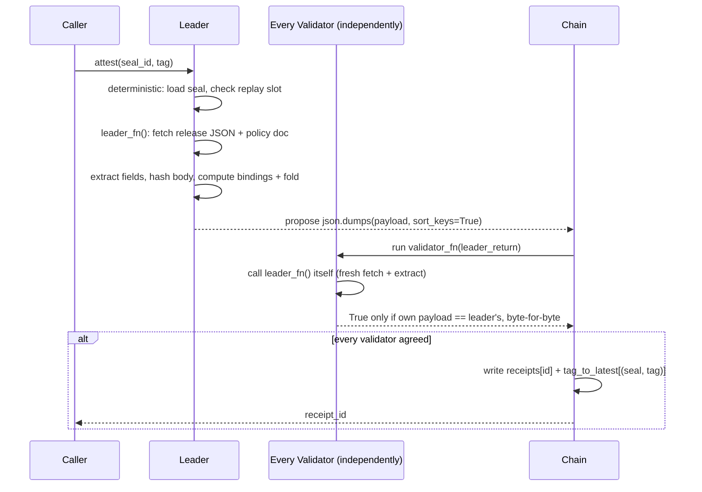

# BoundReleaseReceipt

A standalone [GenLayer](https://genlayer.com) Intelligent Contract primitive that **seals a release channel and issues a release receipt only when every validator independently re-fetches and re-extracts both the live GitHub release and the sealed policy document, and every deterministic binding holds.**

It answers one narrow, checkable question — *"is this exact tag a valid release from this sealed channel, right now?"* — without any model judgment, any confidence percentage, or any leader-trust shortcut.

> **Deployed and proven live:** `0xA85721785d6d3091458CbEAa1555149db322B9ca` on GenLayer Studio Devnet. Two finalized transactions sealed this repository's own release channel and issued `receipt-0` with fold `attested` for release `v1.0.0`. Details below.

## The trust problem it closes

A contract that wants to attest "this release happened, and it complied with this policy" has two ways to get it wrong:

1. **Validator only checks the shape of the leader's answer.** If a validator accepts a well-formed JSON blob without re-fetching the source itself, the leader can fabricate any release. This contract's validator never does that — it calls `leader_fn()` itself (a completely fresh fetch and extraction of *both* sources) and compares its own normalized payload byte-for-byte against the leader's.
2. **A quantitative outcome not exactly agreed on.** A score, a confidence band, a "mostly-compliant" tier — anything like that makes two honest nodes diverge. This contract compares only strings, one integer, one sorted list, and two SHA-256 digests, and reduces them to a fold that is ordinary deterministic Python. Identical observations always produce an identical payload.

## What it does

A caller first **opens a seal** (`open_seal`), describing a release channel:

| Seal field | Meaning |
|---|---|
| `schema` | must be `"brr.seal.v1"` |
| `repo` | `owner/name`, `[A-Za-z0-9_.-]` only |
| `policy_url` | `https://` URL of the release policy document, no embedded credentials |
| `policy_sha256` | exactly 64 lowercase hex — the expected SHA-256 of that document |
| `allowed_authors` | 1–20 GitHub logins, each ≤ 39 chars |
| `required_asset` | a build asset (by exact filename) that must be attached |
| `window_start` / `window_end` | unix seconds; `window_end > window_start`; span ≤ 180 days |

Then a caller calls **`attest(seal_id, tag)`**. Every node — leader *and* every validator, independently — re-fetches the GitHub release JSON for that tag and the policy document from scratch, extracts the same canonical fields, and recomputes the same deterministic bindings. Only a payload every validator independently reproduces is accepted, and the receipt records the resulting fold.

### The fold

The fold is a pure function of two booleans and five bindings. No model, no partial credit.

| Condition | Fold |
|---|---|
| both sources fetched OK, all five bindings `True` | `attested` |
| both sources fetched OK, at least one binding `False` | `rejected` |
| either source failed to fetch (network, non-2xx, unparseable/missing field) | `unresolved` |

`unresolved` is deliberately *not* a decision: a receipt is still stored (so the caller can inspect what failed), but the `(seal, tag)` slot stays retryable. An `attested` or `rejected` fold consumes the slot permanently.

### The bindings

| Binding | Computed as |
|---|---|
| `tag` | fetched `tag_name` == requested tag |
| `author` | fetched `author.login` ∈ `allowed_authors` |
| `timing` | `window_start ≤ published_at ≤ window_end` |
| `asset` | `required_asset` present in the fetched asset-name list |
| `policy` | fetched policy body SHA-256 == sealed `policy_sha256` |

The release **body** is hashed and never interpreted — its SHA-256 is the only thing it contributes, so prompt-injection text in a release body cannot change the tag, author, assets, or any binding.

## Contract interface

| Method | Kind | Description |
|---|---|---|
| `open_seal(seal_json: str) -> str` | write | Validate and persist a seal; returns its `seal_id` (`seal-0`, `seal-1`, …) |
| `attest(seal_id: str, tag: str) -> str` | write | Re-fetch both sources under independent re-execution consensus and issue a receipt; returns its `receipt_id` |
| `get_seal(seal_id: str) -> str` | view | Normalized seal JSON |
| `get_receipt(receipt_id: str) -> str` | view | Full receipt JSON (fold, extracted fields, bindings, `submitted_by`) |
| `get_latest_for_tag(seal_id: str, tag: str) -> str` | view | `receipt_id` of the most recent receipt for `(seal_id, tag)` — read its `fold` |
| `get_seal_count() -> u256` | view | Total seals ever opened |
| `get_receipt_count() -> u256` | view | Total receipts ever issued |

## How consensus actually works here



Because `leader_fn` and `validator_fn` each do their own fetch and their own extraction, and because the validator's only input from the leader is the payload *string* it compares against its own independently derived string, there is no code path where a well-formed but fabricated leader payload is accepted.

## Repository layout

```
contracts/BoundReleaseReceipt.py              the contract
tests/direct/                                 gltest direct-mode test suite (40 tests)
scripts/live_smoke.py                         optional live open_seal + attest reproduction (key via env)
docs/DESIGN.md                                design rationale, non-determinism boundaries, threat model
docs/POLICY.md                                the release policy document used by the live demonstration
docs/WHY_THIS_PASSES_REVIEW.md                mapping against known Portal rejection patterns
PORTAL_SUBMISSION.md                          submission text for the GenLayer Portal
SECURITY.md                                   scope and vulnerability reporting
CHANGELOG.md                                  release history
.github/workflows/ci.yml                      lint + validation + direct tests on every push
```

## Testing

The suite runs the contract in gltest's direct mode with mocked web responses — no network, no live node required.

```bash
pip install -r requirements-test.txt
# Pin the genvm-manager release whose bundle ships the runner named in the header:
export GENVM_VERSION=v0.6.0-rc8          # PowerShell: $env:GENVM_VERSION="v0.6.0-rc8"
genvm-lint check contracts/BoundReleaseReceipt.py
gltest tests/direct/test_bound_release_receipt.py -v
```

40 direct-mode tests cover: the full seal-validation surface (schema, repo, sha, author list, window, policy URL), the attested happy path, each binding-driven `rejected` path (author, asset, timing, policy-hash, tag), both required-fetch failures (`unresolved`), the replay rule (blocked after a decision, allowed after `unresolved`), a dishonest-leader disagreement and a leader-error disagreement, body-injection resistance, two independent tags on one seal, the view error surface, and the pure deterministic helpers. `genvm-lint check` passes with zero warnings and `genvm-lint validate` passes semantic validation.

## Live deployment on GenLayer Studio Devnet

The contract is deployed and was exercised end-to-end — two finalized consensus transactions — against a *real* GitHub release, not a mock.

| | |
|---|---|
| Network | GenLayer Studio Devnet (`https://studio-dev.genlayer.com/api`) |
| Contract address | `0xA85721785d6d3091458CbEAa1555149db322B9ca` |
| Deploy transaction | `0x9c3c51c1beb7470a3819347c056d81638e4aefc386ca846bd02e54c815f34203` — `Finalized · Accepted` |

The smoke test sealed this repository's own release channel (policy document `docs/POLICY.md`, `required_asset = provenance.json`) and then attested release `v1.0.0`:

| | |
|---|---|
| Seal | `seal-0` — tx `0xcaac665d10b921bef0a343bf596115646c4d20d838ce37a46d442d8b19aa5497` (finalized) |
| Attest | `receipt-0` — tx `0xe7755776fc07969e60863921ae4a9faef1070955ce063dbec3ad887a724aa10a` (finalized, round-0 outcome `Accepted`) |
| Fold | **`attested`** — all five bindings `true` |

```json
{
  "schema": "brr.receipt.v1",
  "receipt_id": "receipt-0",
  "seal_id": "seal-0",
  "repo": "Fortune9thx/bound-release-receipt",
  "tag": "v1.0.0",
  "fold": "attested",
  "release_ok": true,
  "policy_ok": true,
  "extracted": {
    "tag": "v1.0.0",
    "author": "Fortune9thx",
    "published_at": 1792214263,
    "assets": ["provenance.json"],
    "body_sha256": "0b2c682d6f8b434687df13cba3a96ac16dc5323ad6925d87262fd0cf938fddb2"
  },
  "policy_sha256": "625bc5d672cb90a54822c1040fc6481a5b6dc5f8e4d29a70a3f6fd3df6bdb672",
  "sealed_policy_sha256": "625bc5d672cb90a54822c1040fc6481a5b6dc5f8e4d29a70a3f6fd3df6bdb672",
  "bindings": {"tag": true, "author": true, "timing": true, "asset": true, "policy": true},
  "submitted_by": "0xC6E6d3b2acCaECeCeB40Ad4bD3dF123DDCB4e537"
}
```

This is the primitive working live: the policy document's SHA-256 (`625bc5d6…b672`, the digest of the committed `docs/POLICY.md` blob) is bound into the receipt as `sealed_policy_sha256` and re-derived by consensus as `policy_sha256`, and the release's author, timing, and required asset were all re-extracted by every validator from the live GitHub release document rather than trusted from the leader.

The same procedure is reproducible with [`scripts/live_smoke.py`](scripts/live_smoke.py), which takes the signing key from the `BRR_PRIVATE_KEY` environment variable and never stores a secret in the repository.

## A note on the SDK header

The contract keeps the canonical GenLayer header exactly:

```
# v0.3.0
# { "Depends": "py-genlayer:5jycge4q8k23462jtb0b9fyey1s9qz928sz2nbrd9mg4sxqg2qng" }
from genlayer import *
```

Under the pinned runner, `from genlayer import *` no longer re-exports the `gl` namespace (that alias existed only in the older `genlayer.gl` layout), so the contract adds `import genlayer as gl` and imports `TreeMap` from `genlayer.storage` explicitly. See [docs/DESIGN.md](docs/DESIGN.md#10-sdk-layout-notes) for the exact reasoning, and `Storage` below.

## Storage

All state is `TreeMap[str, str]` of JSON strings plus two `u256` counters:

| Field | Type | Purpose |
|---|---|---|
| `seals` | `TreeMap[str, str]` | `seal_id` → normalized seal JSON |
| `receipts` | `TreeMap[str, str]` | `receipt_id` → receipt JSON |
| `tag_to_latest` | `TreeMap[str, str]` | `seal_id + "/" + tag` → latest `receipt_id` |
| `seal_counter` | `u256` | seals opened |
| `receipt_counter` | `u256` | receipts issued |

Generic storage classes are allocated from their bare annotations by the SDK; only the two scalar counters are assigned in `__init__`. There are no funds, no reputation, no scores, and no privileged roles anywhere in the contract.

## License

[MIT](LICENSE)
